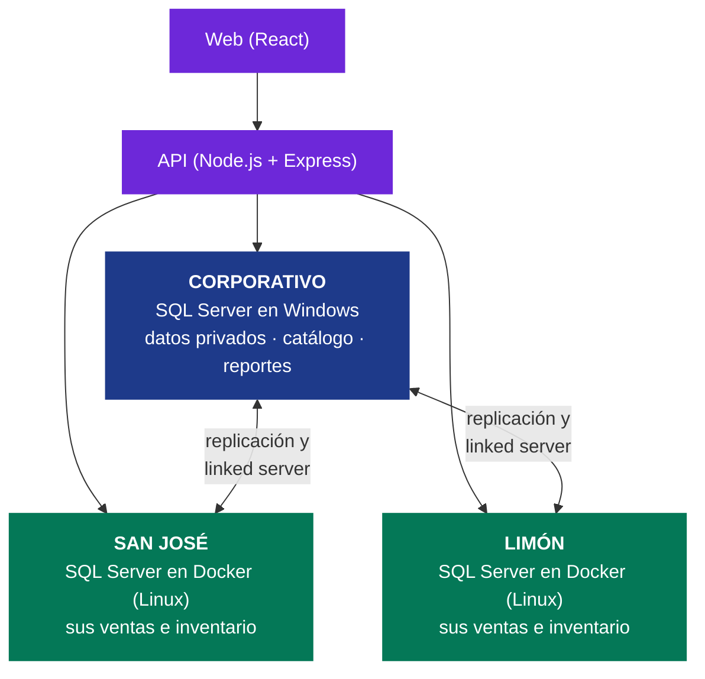
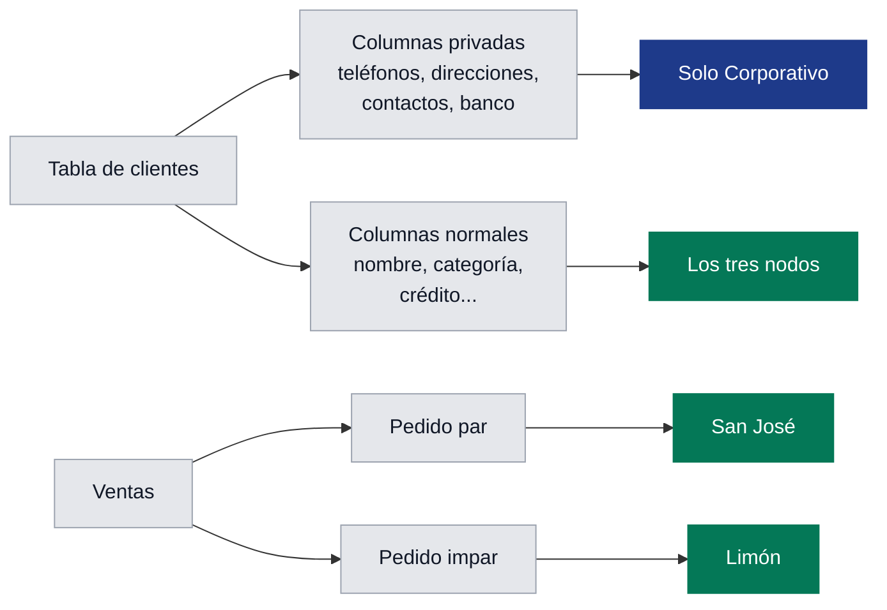

<div align="center">

# Proyecto 2 — Base de datos distribuida

### Wide World Importers

**Bases de Datos II** · Instituto Tecnológico de Costa Rica

Alice Arias Salazar · Heldyis Agüero Espinoza
Prof. Cristian Paz Campos Agüero

<br>


</div>

---

La empresa tiene **una oficina central (Corporativo) y dos sucursales (San José y Limón)**. En lugar de una sola base de datos, cada lugar tiene la suya, y las tres trabajan juntas. Se usa la aplicación web del Proyecto 1, adaptada a este modelo.

---

## 1. Tecnologías usadas

| | Tecnología | Para qué se usó |
|---|---|---|
|  | **SQL Server 2022** | Motor de base de datos de los tres nodos |
|  | **Windows** | Sistema donde corre el Corporativo |
| -E95420?style=flat-square&logo=ubuntu&logoColor=white) | **Ubuntu en WSL** | Linux dentro de Windows, donde corren las sucursales |
|  | **Docker y Docker Compose** | Un contenedor de SQL Server en Linux por cada sucursal (`docker-compose.yml`) |
|  | **Node.js** | Ejecuta la API |
|  | **Express** | Rutas de la API (`/api/clientes`, `/api/reportes`...) |
|  | **mssql** | Librería de Node.js para conectarse a SQL Server |
|  | **React** | Pantallas de la aplicación web |
|  | **Vite** | Servidor de desarrollo de la web |
|  | **xlsx (SheetJS)** | Descargar los reportes en Excel |
|  | **SQL Server Management Studio** | Ejecutar y revisar los scripts |
|  | **Git y GitHub** | Control de versiones |

---

## 2. Los tres nodos



| Nodo | Dónde corre | Qué guarda |
|---|---|---|
| **Corporativo** (Escazú) | SQL Server en **Windows**, puerto 1433 | Datos privados de clientes y proveedores, el catálogo original, los usuarios y una copia de las ventas de las dos sucursales para los reportes |
| **San José** | SQL Server en **Docker (Linux)**, puerto 1436 | Sus ventas, su inventario y una copia del catálogo |
| **Limón** | SQL Server en **Docker (Linux)**, puerto 1437 | Sus ventas, su inventario y una copia del catálogo |

La web le pide los datos a la API, y la API se conecta **al nodo del usuario que inició sesión**.

---

## 3. Conceptos principales

### Fragmentación: repartir los datos

Fragmentar es **partir una tabla** para que cada nodo guarde solo lo que le corresponde.



- **Vertical (por columnas):** de clientes, proveedores y personas se separaron los **datos privados**: teléfonos, direcciones, contactos y datos bancarios. Esas columnas **se borraron de las sucursales** y solo existen en el Corporativo.
- **Horizontal (por filas):** cada sucursal guarda **solo sus propias ventas**. Pedido **par** → San José, pedido **impar** → Limón. La factura y sus líneas van con su pedido, para que nunca queden separados.
- **Inventario:** cada sucursal tiene sus propias existencias (se repartieron mitad y mitad).

> [!NOTE]
> Las ventas nuevas quedan en la sucursal donde se hacen. Cada sucursal usa su propio rango de números de factura (San José desde 10 000 000 y Limón desde 20 000 000), así nunca se repiten.

> [!TIP]
> **Comprobación:** al sumar las facturas de las dos sucursales da exactamente el total original (70 510). No falta ninguna y ninguna está repetida.

### Replicación: el mismo catálogo en todas partes

El **catálogo de productos** (nombre, precio, proveedor, colores, empaques) tiene que ser igual en los tres nodos. Para eso se usa la **replicación transaccional** de SQL Server:

1. Los productos se crean, modifican o eliminan **solo en el Corporativo**.
2. SQL Server copia el cambio automáticamente a San José y Limón en pocos segundos.

Aunque el Administrador cree el producto desde su sucursal, la sucursal se lo envía al Corporativo y espera a que regrese la copia.

### Linked servers: que los nodos se hablen

Un **linked server** es un "enlace" que permite a un SQL Server consultar a otro como si fuera propio.

| Enlace | Está en | Para qué |
|---|---|---|
| `CORPORATIVO` | Cada sucursal | Enviar productos y pedir datos privados con permiso |
| `LS_SANJOSE` y `LS_LIMON` | Corporativo | Traer las ventas de las sucursales a los reportes |

Los enlaces no usan `sa`: usan logins propios con permisos limitados.

### Sinónimos: no importa dónde esté el dato

Los procedimientos del Proyecto 1 usan nombres como `Facturas` o `ClientesActuales`. Esos nombres son **sinónimos** que apuntan a la tabla real, esté en el mismo nodo o en otro. Por eso los procedimientos casi no cambiaron.

---

## 4. Usuarios y seguridad

| Rol | Qué puede hacer |
|---|---|
| **Administrador** | Ve clientes, proveedores, inventario y ventas de **su** sucursal. Crea, modifica y elimina productos. Clientes y proveedores son solo de consulta |
| **Corporativo** | Ve los reportes de una sucursal o de las dos juntas, y aprueba las solicitudes de acceso |

- **Contraseñas cifradas:** la tabla de usuarios está en el Corporativo y la contraseña se guarda cifrada (AES-256, cifrado propio de SQL Server).
- **La API nunca usa `sa`:** según quién inició sesión, se conecta con un login que **solo puede ejecutar procedimientos**, no leer tablas.
- **Datos privados con permiso:** el Administrador los ve como `xxxx`. Puede pedir acceso, y si el Corporativo lo aprueba, los ve durante unas horas.

> [!IMPORTANT]
> La regla de los datos privados la revisa **la base de datos**, no solo la pantalla.

---

## 5. Reportes

- Cada 5 minutos, un trabajo automático (job de SQL Server Agent) **trae al Corporativo las ventas nuevas** de las sucursales. También se puede hacer al momento con el botón de la web.
- Los **11 reportes** del Proyecto 1 tienen un filtro: **Consolidado, San José o Limón**.
- **Vistas materializadas y tablas de resumen:** SQL Server guarda los totales ya calculados y los actualiza solo cuando entran ventas nuevas. Así los reportes responden al instante en lugar de tardar casi un minuto.
- Se pueden descargar en **Excel**.

---

## 6. Si un nodo se cae

| Qué se cae | Qué pasa |
|---|---|
| **Una sucursal** | La otra sigue funcionando normal. En los reportes aparece "sin conexión" y se muestran sus últimos datos. No se pueden eliminar productos, porque no se puede revisar si tienen ventas ahí |
| **El Corporativo** | Las sucursales siguen vendiendo y consultando. No se puede iniciar sesión, cambiar productos ni ver datos privados |
| **Vuelve el nodo** | La replicación y la sincronización se ponen al día solas |

---

## 7. Dos personas a la vez (concurrencia)

- Todos los cambios del catálogo se hacen en **un solo lugar** (el Corporativo), así que dos sucursales nunca chocan.
- Si dos administradores editan el **mismo producto** al mismo tiempo, el segundo que guarda recibe el aviso *"Otro usuario modificó este producto"* y no se pierde el cambio del primero.
- No se pueden crear dos productos con el mismo nombre al mismo tiempo.

---

## 8. Cómo ejecutarlo

La instalación completa en una computadora nueva está en **[INSTALACION.md](INSTALACION.md)** (`./instalar_todo.sh` instala todo en orden).

**Día a día** (en Ubuntu):

```bash
./levantar.sh                  # enciende las sucursales (Docker)
cd Api && npm run dev          # API (Node.js)
cd WebSite && npm run dev      # Web (React) → http://localhost:5173
./bajar.sh                     # al terminar
```

> [!WARNING]
> `Api/.env` se copia de `Api/.env.ejemplo`. Las contraseñas van **entre comillas** y este archivo **no se sube a GitHub**.

**Usuarios de prueba:**

| Usuario | Contraseña | Rol |
|---|---|---|
| `admin.sanjose` | `Admin#2026` | Administrador de San José |
| `admin.limon` | `Admin#2026` | Administrador de Limón |
| `gerente.corporativo` | `Gerente#2026` | Corporativo |

---

## 9. Scripts (`Script/`)

Se ejecutan en orden. Los de sucursal son los mismos para San José y Limón.

| # | Nodo | Qué hace |
|---|---|---|
| 01 |  | Marca cada venta con su sucursal |
| 02 |  | Fragmentación: quita datos privados y deja solo sus ventas |
| 03 |  | Login para que las sucursales entren al Corporativo |
| 04 |  | Linked server hacia el Corporativo |
| 05 |  | Login para que el Corporativo entre a las sucursales |
| 06 |  | Linked servers hacia las sucursales |
| 07 |  | Prepara el catálogo para replicarse |
| 08 |  | Replicación del catálogo |
| 09 |  | Tabla de usuarios con contraseña cifrada |
| 10 |  | Logins y permisos de la API |
| 11 |  | Login y permisos de la API |
| 12 |  | Sinónimos |
| 13 |  | Procedimientos del Proyecto 1 adaptados |
| 14 |  | Crear, modificar y eliminar productos |
| 15 |  | Productos desde la sucursal |
| 16 |  | Sincronización y reportes |
| 17 |  | Solicitudes de acceso a datos privados |

`Script/Proyecto1_original/` guarda los scripts del Proyecto 1 solo como referencia: **no se ejecutan**.

---

## 10. Limitaciones

- Las ventas viejas se repartieron por número par o impar, porque los datos originales no decían la sucursal.
- Los reportes pueden tener hasta 5 minutos de atraso (o se actualizan con el botón).
- Los tres SQL Server corren en una misma laptop, así que la primera vez que se abre un reporte puede tardar un poco más.
